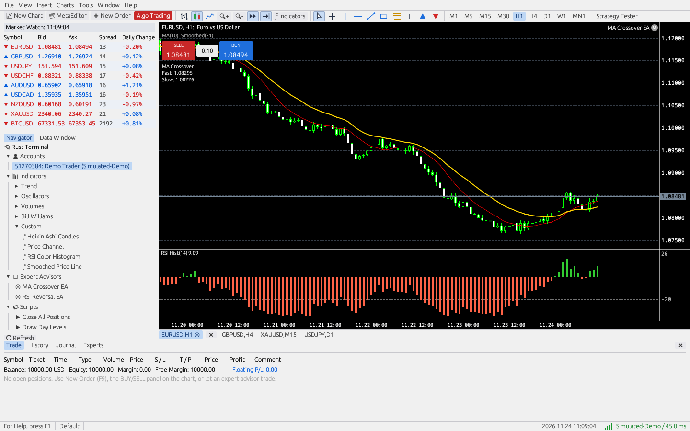

# Rust Terminal

A cross-platform (Windows / macOS / Linux) trading terminal written in Rust with
[egui](https://github.com/emilk/egui). It has charts, built-in indicators, a simulated demo
account, a strategy tester, and a built-in **MQL5 interpreter** that runs custom indicators,
expert advisors (EAs) and scripts straight from `.mq5` source code.



> **Note:** Prices and accounts are **simulated**. Rust Terminal does not connect to a real
> broker and cannot place real trades.

## Features

- **Market Watch**: 9 simulated symbols (EURUSD, GBPUSD, USDJPY, USDCHF, AUDUSD, USDCAD,
  NZDUSD, XAUUSD, BTCUSD) with a live tick generator, bid/ask, spread and daily change.
- **Charts**: candles, bars or line, all timeframes from M1 to MN1, several chart tabs, zoom,
  chart shift, crosshair and one-click trading (BUY/SELL panel).
- **16 built-in indicators**: Moving Average, Bollinger Bands, Envelopes, Ichimoku, Parabolic
  SAR, Alligator, Fractals, MACD, RSI, Stochastic, ATR, CCI, Momentum, ADX, Williams' %R,
  Volumes.
- **Drawing objects**: horizontal/vertical lines, trend lines, Fibonacci retracement,
  rectangles, text and arrows.
- **Simulated demo account**: market and pending orders, stop loss / take profit, margin,
  margin call and stop out, hedging mode, trade history and journal.
- **MetaEditor-style code editor**: write `.mq5` files and compile them, with errors reported
  by line.
- **MQL5 engine**: runs custom indicators (`OnCalculate`), expert advisors (`OnInit`,
  `OnTick`, `OnTimer`, `OnTrade`, …) and scripts (`OnStart`) on the live chart.
- **Strategy Tester**: back-test EAs with "every tick", "1 minute OHLC" or "open prices only"
  modelling, and get a report with net profit, profit factor, expected payoff, drawdown and
  trade counts.

## Getting started

### Requirements

- [Rust](https://rustup.rs/) (stable, edition 2021)
- On Linux, the usual libraries for an OpenGL window (X11 or Wayland). For example on
  Debian/Ubuntu:

  ```sh
  sudo apt install libx11-dev libxkbcommon-dev libgl1-mesa-dev libwayland-dev
  ```

### Build and run

```sh
git clone https://github.com/DayanLeksonoPutro/RustTerminal.git
cd RustTerminal
cargo run --release
```

Other commands:

```sh
cargo build                          # debug build
cargo test                           # engine tests
cargo run -- --screenshot out.png    # open the window, save a screenshot, then exit
```

## Writing your own programs

On first start the terminal creates an `MQL5` folder and copies some example programs into it:

| Platform | Data folder |
|---|---|
| Windows | `%APPDATA%\RustTerminal` |
| macOS | `~/Library/Application Support/RustTerminal` |
| Linux | `$XDG_DATA_HOME/RustTerminal` (or `~/.local/share/RustTerminal`) |

Set the `RUST_TERMINAL_DATA` environment variable to use another folder.

```
MQL5/
  Indicators/   custom indicators
  Experts/      expert advisors
  Scripts/      scripts
  Include/      files for #include
```

Put your `.mq5` files in these folders (or create a new one from a template in
**MetaEditor**), then double-click a program in the **Navigator** to attach it to the active
chart. Trading from an EA needs the
**Algo Trading** button to be on.

Included examples:

- Indicators: *Smoothed Price Line*, *RSI Color Histogram*, *Price Channel*,
  *Heikin Ashi Candles*
- Expert advisors: *MA Crossover EA*, *RSI Reversal EA*
- Scripts: *Close All Positions*, *Draw Day Levels*

A minimal indicator:

```mql5
#property indicator_chart_window
#property indicator_buffers 1
#property indicator_plots   1
#property indicator_type1   DRAW_LINE
#property indicator_color1  clrGold

input int InpPeriod = 14;
double Buffer[];

int OnInit()
{
   SetIndexBuffer(0, Buffer, INDICATOR_DATA);
   return INIT_SUCCEEDED;
}

int OnCalculate(const int rates_total, const int prev_calculated, const int begin,
                const double &price[])
{
   for (int i = MathMax(prev_calculated - 1, InpPeriod); i < rates_total; i++)
   {
      double sum = 0;
      for (int k = 0; k < InpPeriod; k++) sum += price[i - k];
      Buffer[i] = sum / InpPeriod;
   }
   return rates_total;
}
```

### What the MQL5 engine supports

- Inputs, enums, structs, arrays, functions, `#property`, `#define` and `#include`
- Indicator buffers and plots, `CopyBuffer` / `CopyClose` / … , `ArraySetAsSeries`
- Trading functions, positions, orders and history from EAs and scripts
- Chart objects from code
- Runtime errors such as "zero divide" and "array out of range" stop the program instead of
  crashing the terminal, and an endless-loop guard stops runaway handlers

Current limits:

- `class` and templates are not supported yet (they give a clear compile error).
- Compiled `.ex5` files cannot run: the format is encrypted. Use the `.mq5` source.

## Project layout

```
src/
  main.rs         entry point and window setup
  app.rs          app state and update loop
  ui.rs           menus, toolbars, Market Watch, Navigator, Toolbox
  chart.rs        chart drawing, indicator plots, objects
  indicators.rs   the 16 built-in indicators
  market.rs       simulated symbols, ticks and bar history
  account.rs      simulated account: orders, positions, margin, SL/TP
  editor.rs       code editor and compiler
  tester.rs       strategy tester engine
  tester_ui.rs    strategy tester panel and report
  host.rs         link between the MQL engine and the live market/account
  storage.rs      data folder and saved accounts
  samples.rs      example programs and templates
  mql/            MQL5 lexer, parser, checker and interpreter
```

[`MECHANICS.md`](MECHANICS.md) describes the indicator defaults, formulas, account rules and
tester rules in detail. [`AGENTS.md`](AGENTS.md) has notes for contributors and AI coding
agents.

## Roadmap

- `class` and template support, so more EAs from the internet run unchanged
- Live prices from a free public feed (for example crypto) as an alternative to the simulator

## Contributing

Issues and pull requests are welcome. Before opening a pull request, please run:

```sh
cargo fmt
cargo clippy --all-targets
cargo test
```

## Disclaimer

Rust Terminal is an independent project and is not affiliated with or endorsed by MetaQuotes.
"MQL5" is used only to describe the language of the programs it runs. This software is for
learning and testing strategies; it is not financial advice.
